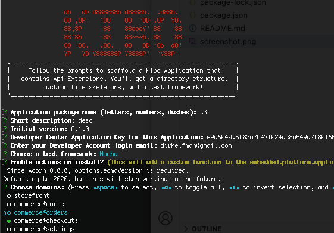

# Kibo API Extension generator

Maintainer: [James Zetlen](https://github.com/zetlen)

A Kibo API Extension generator for Yeoman that provides boilerplate and structure for writing Kibo Api Extension Functions against the family of Kibo API Extensions. It provides documented function stubs, a build process using Grunt and Browserify, remote sync with the Developer Center, and unit tests using Mocha plus the Kibo Action Simulator.



## Usage

First, install [Yeoman](http://yeoman.io)'s command line tool if you haven't already!

```bash
npm install yo  -g
```

Yeoman looks for globally installed NPM packages that identify themselves as Yeoman generators. So install the generator globally. Also, install the `grunt-cli` command line Grunt package, because you'll need it.

```bash
npm install -g generator-mozu-actions grunt-cli
```

Make a new directory and `cd` into it:
```
mkdir example && cd example
```

Run the Yeoman generator!
```
yo mozu-actions
```

## Options

* `--skip-install`
  
  Skips the automatic execution of `npm install` after scaffolding has finished.

* `--skip-prompts`

  Often you may find yourself rerunning the generator in the same directory. Your answers to prompts are saved; if you want to quickly re-run the generator without prompts, use this option. Will not work if you've never run the generator in this directory before.

* `--quick`
  
  Equivalent to `--skip-install --skip-prompts`.

* `--internal`

  Allows integration with non-production Mozu environments. The prompts will include an extra question about which environment to sync with.


## Shared context (ArcJs): `kibo.json`

Generated apps carry a `kibo.json` at the project root, created and kept complete by the generator. Every entry starts as `"none"`. The `manifest` grunt task comes from [`grunt-mozu-appdev-sync`](https://github.com/Mozu/grunt-mozu-appdev-sync) 2.5.0 or later, which the generator installs (not with `--skip-install` or `--quick`: then add `grunt-mozu-appdev-sync@^2.5.0` yourself). It:
- reads `kibo.json`;
- **fails the build** if the file is missing, if it lacks a top-level `contextReuse`, or if any `*.manifest.js` bundle has no entry;
- writes the `arcjs` block into `assets/functions.json`.

Run `grunt build --kibo-init` to be prompted (`warm` or `none`) for the missing values. The plugin's README has the full rules.

The generator adds entries for new manifests and never changes or removes existing ones. If you delete a manifest, delete its `kibo.json` entry too: the build rejects an entry that matches no manifest. If `kibo.json` is not valid JSON, or a value is not `warm` / `none`, the generator leaves it as it is and says so. The build checks more (unknown options, keys that match no manifest) and reports those itself.

**Existing apps.** Older apps carry their own `tasks/manifest.js`, which takes precedence over the plugin's task. Re-running the generator on such an app prints a warning and does not touch that file. To switch: set `grunt-mozu-appdev-sync` to `^2.5.0`, delete `tasks/manifest.js` (carry over local changes first), run `grunt build --kibo-init` and commit `kibo.json`. See `specs/arcjs-context-reuse/spec.md`.

## Creating Additional Actions

The generator uses a Yeoman sub-generator to create the action implementation scaffolds and unit test scaffolds. You can call this sub-generator directly, after creating your project, to add more scaffolding for additional actions:

```
yo mozu-actions:action
```

This will prompt you to add to your list of actions, and then will write the additional action scaffolds.
